<p align="center">
  <a href="https://github.com/Hollownett/dishonored2-vr/releases/latest">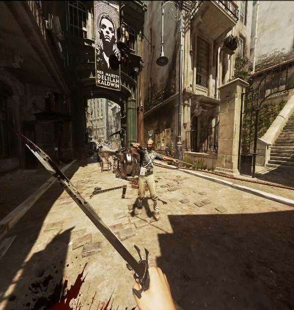</a>
</p>

Dishonored 2 VR
===============

**Native VR for Dishonored 2.** Stereo 3D, head tracking, two tracked hands, motion combat and the game's own menus in the headset.
One launcher file installs it next to your Steam copy of the game; nothing from the game is redistributed.

<p align="center">
  <a href="https://github.com/Hollownett/dishonored2-vr/releases/latest"><b>Download the latest release</b></a> ·
  <a href="#install-and-play">Install</a> ·
  <a href="#controls">Controls</a> ·
  <a href="#troubleshooting">Troubleshooting</a> ·
  <a href="docs/VR-v1123-RELEASE.md">What's new</a>
</p>

<p align="center">
  <a href="https://github.com/Hollownett/dishonored2-vr/releases/latest"></a>
  <a href="https://github.com/Hollownett/dishonored2-vr/releases"></a>
  <a href="https://github.com/Hollownett/dishonored2-vr/stargazers"></a>
  <a href="LICENSE"></a>
</p>

<p align="center">
  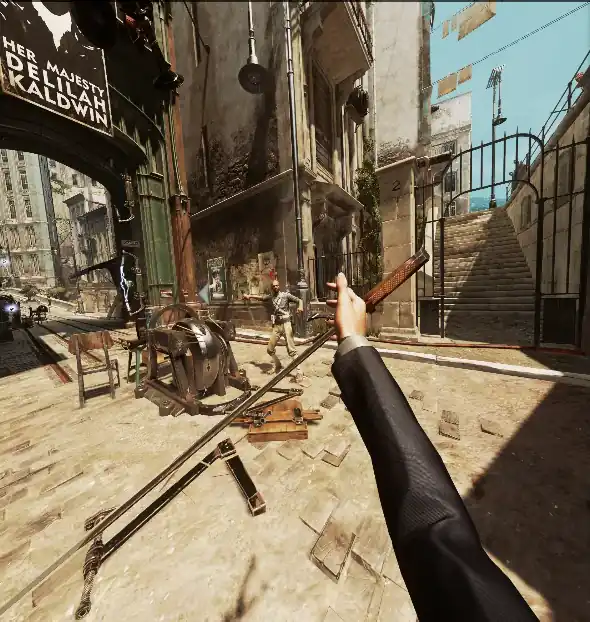<br>
  <sub>Mirror recording of a headset session. All pictures on this page are from the author's own play sessions.</sub>
</p>

> **Works today, still growing.** The mod is complete enough to play the whole game in VR. Headset time finds things the
> author's tests cannot, so please say what you see: [open an issue](https://github.com/Hollownett/dishonored2-vr/issues).
> **The game's tutorial section does not fully work in VR yet.** Its on-screen prompts and scripted steps are made for
> a gamepad and may not match the VR controls; use the Controls list below.

Features
--------

- **Real stereo 3D at your headset's resolution**, with the headset's own view mask, foveated upscaling and a frame pacer
  built for 90 Hz. Snap or smooth turning, a comfort vignette while moving, and physical crouch and lean.
- **Your own hands.** Corvo's or Emily's hands and arms follow your controllers; the fingers close as you squeeze and
  wrap around what you hold. Grab bottles, lanterns, bodies and loose props by their real shape, carry them, throw them.
- **Motion combat.** Swing the sword to attack, hold it up to block, throw it and call it back. Charge a power strike.
  Take unaware guards down from behind, choke them out, or clamp a hand on their face and throw them down.
- **Two weapons, one in each hand.** Each hand has its own wheel (X left, A right); pick the pistol or crossbow on both:
  a real second weapon with its own ammo, your upgrades, and the game's own fire, reload and empty animations and sounds.
- **Body holsters and a wrist watch.** Sword over either shoulder, gun or crossbow at either hip. Turn the back of
  your left wrist to your face for health, mana and ammo. Notes and maps open in your left palm.
- **The world reacts to your hands.** Push doors open or crack them to peek, turn valves, drag and carry bodies over
  your shoulder, hold the Heart up and listen.
- **The game's own UI, in VR.** Menus, the Quick Access Wheel, journal and notes float in front of you; point and pull the
  trigger. A **VR Settings** page lives in the pause menu. Cutscenes play in 3D or on a theatre screen.
- **Upscaling and anti-aliasing you can choose.** FSR 3 (default), FSR 4, SMAA, the game's TAA, or DLAA/DLSS on NVIDIA
  with your own `nvngx_dlss.dll`. A performance mode renders one eye per frame when the GPU is short.
- **One launcher** installs everything into `%LOCALAPPDATA%\DishonoredVR`, checks your setup, edits settings and starts
  the game in VR. It never touches the game's files.

<p align="center">
  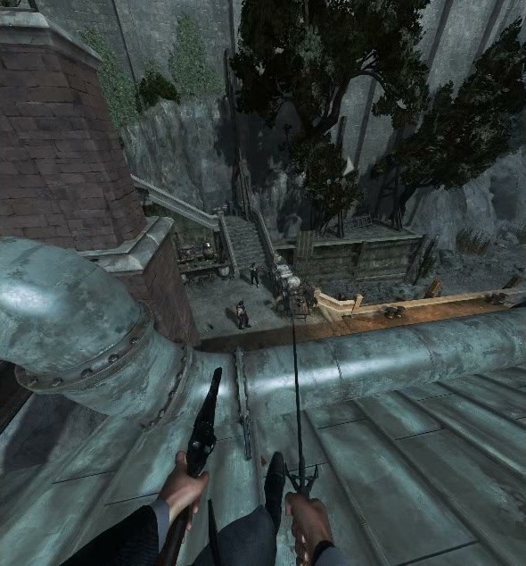
  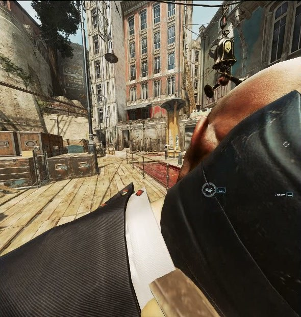
  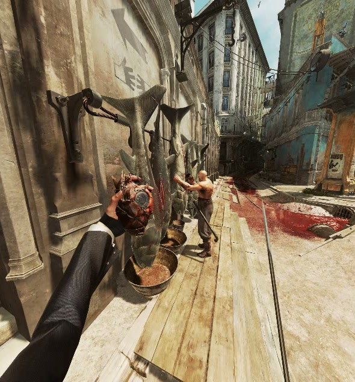
</p>
<p align="center">
  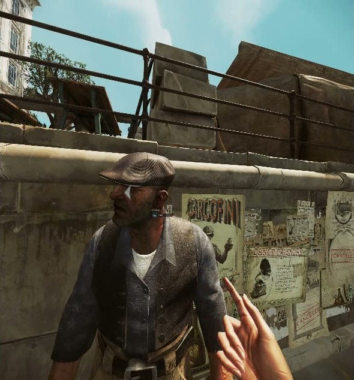
  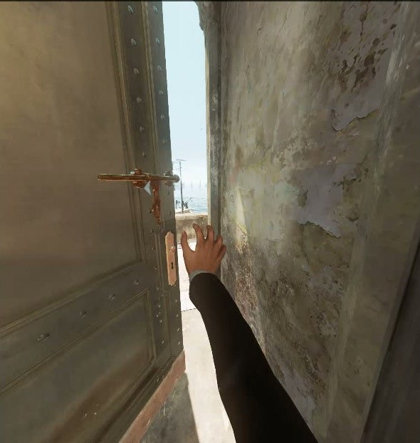
  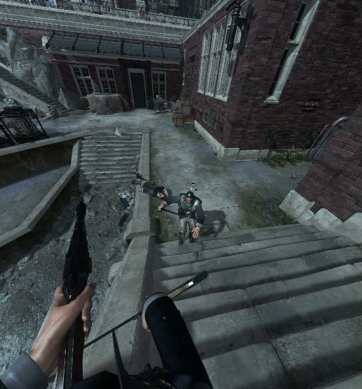
</p>
<p align="center">
  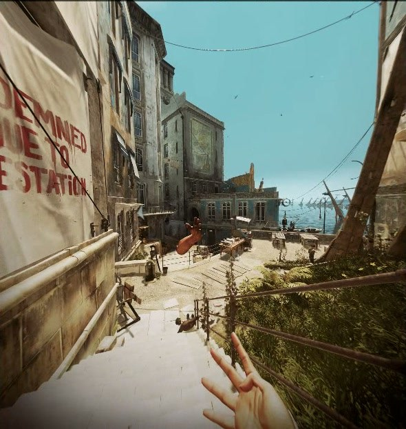
  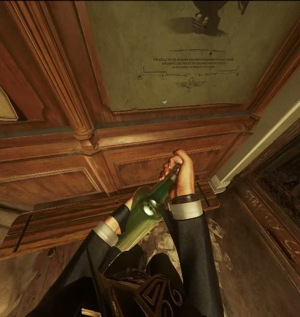
  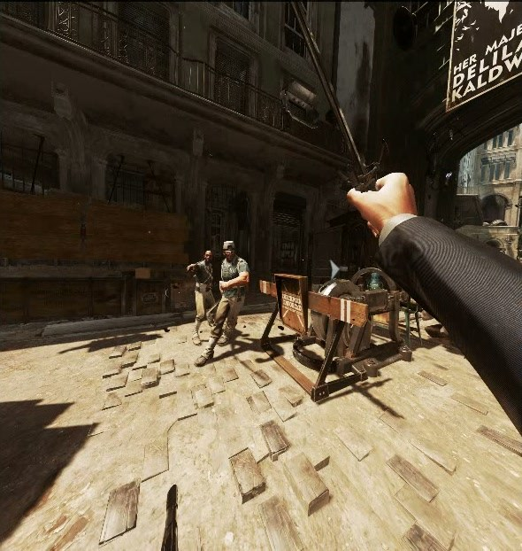
</p>

What you need
-------------

- **Windows 10 or 11**, 64-bit, and **Dishonored 2 on Steam**, installed and updated.
- A **PC VR headset with an OpenXR runtime**. Played and tuned on Meta Quest 3 through **Virtual Desktop** (VDXR); SteamVR
  and Steam Link work too. Any OpenXR headset should; the mod reads its views and sizes from the runtime.
- **SteamVR installed**, even with Virtual Desktop: the mod loads the OpenXR loader from SteamVR's folder.
- The **Microsoft Visual C++ 2015-2022 x64** runtime.
- A **strong GPU**. Both eyes render at headset resolution; the game runs windowed or borderless.

Linux (Proton + SteamVR + Steam Link) has an experimental path: [linux/README.md](linux/README.md).

Install and play
----------------

1. Download `DishonoredVRLauncher.exe` from the [latest release](https://github.com/Hollownett/dishonored2-vr/releases/latest).
2. Put it anywhere and run it. On first start it installs the mod into `%LOCALAPPDATA%\DishonoredVR` and imports menu art
   and the tutorial pictures from **your own** game install.
3. Fix anything red on the **Play** page. Each check says how.
4. Start Virtual Desktop (Synchronous Spacewarp **disabled**, 72 or 90 Hz) or SteamVR, then press **LAUNCH VR**.
   The game starts through Steam, VR attaches at the title screen about 20 seconds after the window appears, and your
   last save continues.

**What the launcher does**

- Places a small loader (`dinput8.dll`) next to `Dishonored2.exe`. It loads only this mod and never replaces another mod's file.
  While it is there, every start of the game is a VR start; **Tools > Uninstall proxy** (game closed) makes it flat again.
- **Settings**: resolution and render scale, anti-aliasing and upscaler, sharpening, HUD size, turning, monitor view,
  cutscene mode. The same page is in the game: pause menu > **VR Settings**.
- **Features**: optional switches such as performance mode, Quest button labels, and **Save diagnostic logs**.
  Logging is **off by default**; nothing is written to disk while you play unless you turn it on for a bug report.
- **Stop VR** ends the session; quitting the game does too.

<p align="center">
  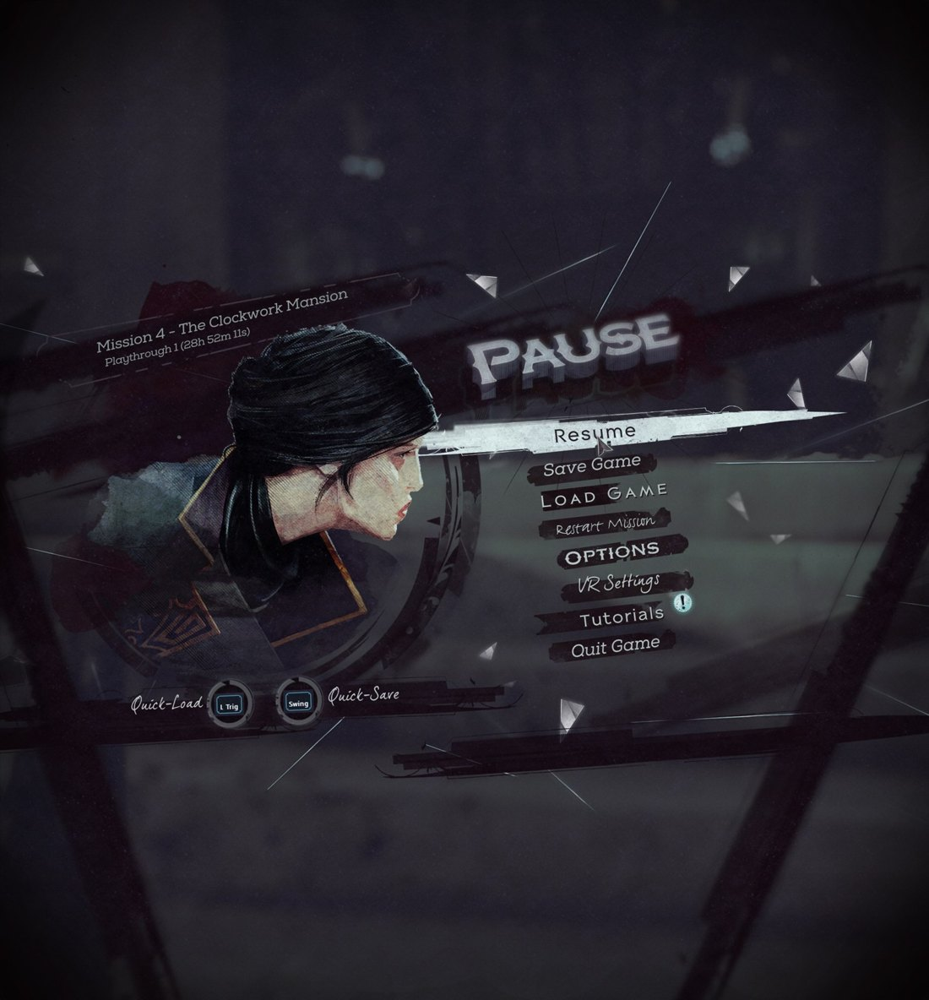<br>
  <sub>Headset capture: the pause menu with the mod's VR Settings page.</sub>
</p>

Controls
--------

Made for Meta Quest Touch controllers; any OpenXR controller with the same buttons works. **Grip** is the side button
under your middle finger, **trigger** is under your index finger. The same guide, with pictures, is in the game
(right grip at your right temple) and on the launcher's **Controls** page.

<p align="center">
  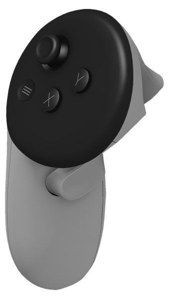
  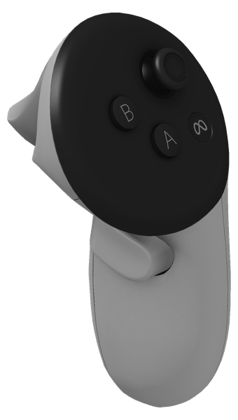
</p>

| Do this | With |
|---|---|
| Move where you look; sprint | Left stick; click it |
| Turn (snap or smooth); crouch; zoom | Right stick; flick it down; click it |
| Jump and climb | Push the right stick up (hold it to swim up or climb), or raise both hands over your head |
| Quick Access Wheel | Hold X for the left hand, A for the right; point at an item, release. It goes to that hand |
| Talk, pickpocket, pick up | Trigger of a free hand |
| Pause; journal; quick slots | Menu; hold it; hold it and flick the right stick |
| Pause menu shortcut | Hold Y |
| Drink a health elixir | B |
| Select in menus and on the wheel | Point with the right controller, right trigger |
| Draw and sheathe the sword | Grip over either shoulder; release it there to sheathe |
| Draw and holster the pistol or crossbow | Grip at either hip; release there to holster |
| Fire, cast, shoot | Trigger of the hand holding the gun, crossbow or power |
| Second gun or crossbow | Pick it on the other hand's wheel |
| Attack | Swing the sword. From behind an unaware guard it is a silent takedown |
| Block | Hold the sword in front of you |
| Power strike | Grip + trigger with the sword held still; pulses rise in the hand; release to swing |
| Throw the sword; call it back | Release the grip mid-swing; grip over your shoulder |
| Health, mana, ammo | Turn the back of your left wrist to your face |
| Use, grab, hold | Grip at what the hand touches or points at; hold at a keyhole to keep the peek |
| Grab a guard | Palm on him + grip; pull hard to throw him down |
| Choke a guard | Grip an unaware guard's neck from behind |
| Drag or carry a body | Grip a limb or the head; let go at your shoulder to carry it |
| Grenade or mine | Make a fist, open it mid-throw; open it against a surface to place a mine |
| Doors | Open hand against the door, push; push slowly to peek |
| Crouch and lean | Do it with your body |

Full list and the design behind it: [docs/VR-CONTROLS.md](docs/VR-CONTROLS.md).

Troubleshooting
---------------

| Problem | Fix |
|---|---|
| The game closes right after starting, or never opens (the game's old AMD file fails on newer systems) | Download [amd_ags_x64.dll](https://github.com/SCell555/amd-ags-stub/releases/tag/v1.1), put it in your game folder and overwrite. The game starts after that |
| The game still does not start | Start the game as administrator: right-click `Dishonored2.exe` in the game folder > Properties > Compatibility > **Run this program as an administrator** |
| Walking looks steppy or the game runs at half rate | Disable Synchronous Spacewarp in Virtual Desktop |
| Nothing happens in the headset | Check the launcher's Play page: the OpenXR runtime (Virtual Desktop or SteamVR) must be active and SteamVR installed |
| The headset disconnected | The mod reconnects by itself after a second or two |
| Low frame rate | FSR Quality or Balanced, a lower render scale in VR Settings, or performance mode under Features |
| The game starts flat | Press LAUNCH VR once; it reinstalls the loader next to `Dishonored2.exe` |
| I want to play flat again | Game closed: Tools > Uninstall proxy |
| Reporting a bug | Turn on **Save diagnostic logs** under Features, reproduce it, and attach `%LOCALAPPDATA%\DishonoredVR\artifacts` (the Tools page opens it). Turn it off afterwards |

Uninstall: close the game, choose **Tools > Uninstall proxy**, then delete the launcher and `%LOCALAPPDATA%\DishonoredVR`.
Game settings the mod changes while VR is on (motion blur, depth of field, camera bob, HUD size) are restored when VR stops.

Building from source
--------------------

Visual Studio 2022 (x64 C++ tools), the .NET 8 SDK and Python 3.

```
tools\build-msvc.cmd                      builds the mod DLL into build\ and runs its checks
cd launcher && dotnet publish -c Release  packs the newest validated DLL into launcher\dist\DishonoredVRLauncher.exe
```

The test harness, simulated-input runs and labs are described in [docs/TESTING.md](docs/TESTING.md);
the launcher in [docs/LAUNCHER.md](docs/LAUNCHER.md).

How it works
------------

The mod is one DLL loaded through a `dinput8.dll` proxy. It hooks the game's D3D11 presentation, renders each eye from the
engine's own camera with the headset's projection, drives the player's real arm and hand skeletons from the controllers, and
talks to the engine's weapon, interaction and animation systems directly so that swings, grabs, doors and the second weapon
use the game's own rules rather than scripted stand-ins. Everything else goes through OpenXR.

**Read more:** [development history](docs/DEVELOPMENT.md) ·
[playing notes](docs/PLAYING.md) · [controls design](docs/VR-CONTROLS-DESIGN.md) ·
[performance plan](docs/ENGINE-PERF-PLAN.md) · [release notes](docs/VR-v1123-RELEASE.md)

Contributing
------------

Bug reports with a short description of what you did and saw are the most useful thing. If you can, record a clip or turn on
**Save diagnostic logs** for that session. Pull requests are welcome; please keep to the engine's own mechanisms and avoid
per-item special cases.

---

Released under the [MIT License](LICENSE). Third-party code and licenses: [THIRD_PARTY_NOTICES.md](THIRD_PARTY_NOTICES.md).
Dishonored 2 is the property of Arkane Studios and Bethesda Softworks. This project is not affiliated with or endorsed by them,
Valve or Meta; it needs your own copy of the game and distributes none of its files.
