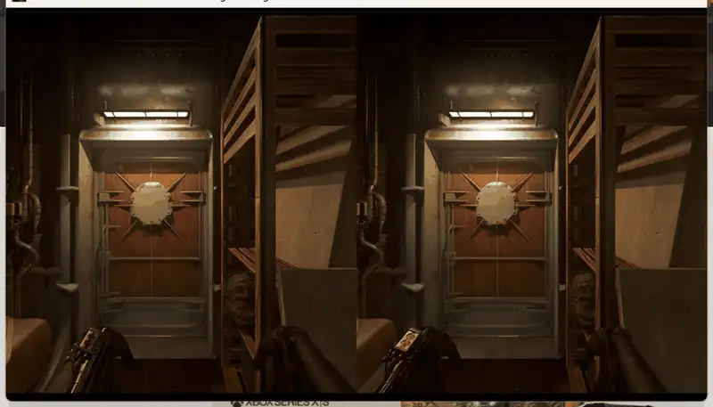
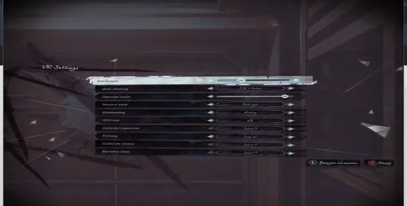
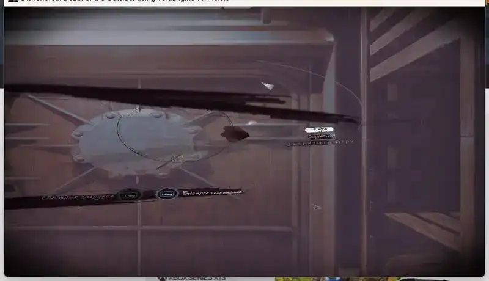

# Death of the Outsider VR

Dishonored: Death of the Outsider (DOTO, Steam app 614570, `Dishonored_DO.exe`) runs on the same Void Engine
family as Dishonored 2. This mod supports it from the **same repository and the same sources**. A generator ports
the Dishonored 2 build to the DOTO executable, and the launcher has an **OUTSIDER** tab that installs and starts it.

Status (2026-11-24): Billie's powers, the dual Voltaic Guns, the Hook Mine and the grip power cancel are built and checked in simulated sessions on Linux (§5, row linux1; headset checklist `docs/VR-DOTO-2026-11-24-TEST-CHECKLIST.md`). Earlier status (2026-11-22, first night): the port pipeline, the DOTO DLL build, the launcher tab and the simulated test runner
exist, and **the VR core runs in Death of the Outsider under the simulated headset**: tracked stereo gameplay with every
frame paired, per-eye head tracking, native turning, comfort settings, per-eye TAA history and the menus on the VR panel
(see §5), Billie's tracked hands and **her full body** (her own coat, torso and Voltaic Gun arm when looking down).
First headset session 2026-11-22 (Virtual Desktop, v145721): controller input did not reach the game, the sword looked
black, quest markers were flat; v145722 addresses the input and marker causes (see the headset row in §5). This document
is the design and the plan. The mod is one source tree for both games (§8).

## 1. How the port works

The Dishonored 2 mod is pinned to one exact executable. About 1,400 addresses (functions, hook sites, vtables,
globals, import slots, cvars) and several hundred struct field offsets are written into `src/` as hex literals, and
many hooks compare the engine's code bytes before they install. DOTO's executable was built by the same toolchain
(same sections, full MSVC RTTI, no Denuvo) from a newer engine branch (VoidEngine v1.145.0.0 against D2's v1.77.9.0).

Rather than fork the sources, `tools/doto/` translates them:

| Step | Tool | What it does |
|---|---|---|
| Index | `pe_index.py` | Every function from `.pdata` (116k in D2, 120k in DOTO), a relocation-masked hash, call and data references; all RTTI vtables by class name. |
| Match | `match.py` | Pairs functions: unique masked hash, vtable slots by RTTI name, call-graph and data-reference propagation, shape, neighbourhood (92k of 116k paired). |
| Align | `align.py` | Instruction alignment of every pair: displacement votes (struct offsets), rip-target votes (globals), immediates. 88.7k of 91.7k pairs are instruction-identical. |
| Translate | `translate.py` | Any D2 address to DOTO with a method (exact, aligned, voted, pattern, cvar by name, import by symbol, rip-reference scan). |
| Inventory | `inventory.py` | Classifies every hex literal in `src/` (code / rdata / data address, field offset, byte check, comment). |
| Port | `port.py` | Writes `build/doto-src/src/`: addresses translated, moved offsets rewritten, byte checks and FNV code pins regenerated when only relocations differ, identity switched (exe name, SHA-256, `D2VR_GAME_DOTO`). Anything it cannot translate becomes a poison RVA beyond the image, so the mod's own checks switch that one feature off instead of touching the wrong code. |
| Review rules | `offsets.json`, `merge_review.py` | Reviewed per-site rules with evidence: line rules for uniformly shifted structs, site offsets, site-scoped addresses, raw text (hex strings, sizes), accepted byte differences. |
| Build | `build-doto.cmd <ver>` | Regenerates and compiles `build/doto/d2vr_render_probe_arm_v<ver>.dll` with the release flags. |
| Review helpers | `fn_diff.py`, `who_shifts.py`, `live.py` | Side-by-side disassembly, "which functions moved this offset", read-only live memory of the running game. |
| Test | `doto_sim.py` | Simulated-VR session in DOTO through the proxy, its own mod home `build/doto-home`, window captures, PC-in-use checks. |

D2 itself is untouched by the port: the D2 build compiles `src/` as before. The only shared-source change so far
is ABI-neutral for D2 (the Iggy hub hook forwards a fourth register argument; see §2).

Numbers at the time of writing: 1,397 address literals translated (967 exact, 261 voted, 115 aligned, 32 reviewed,
22 other), 16 unique addresses poisoned (all in weapon, door and grenade feature code), 380 offsets rewritten.

## 2. Engine differences found so far

| Area | Dishonored 2 | Death of the Outsider | Evidence |
|---|---|---|---|
| `renderView_t` (the camera the mod writes per eye) | 16 bytes at +0x4c | removed: every field after +0x48 is 0x10 lower (FOV +0x8c, position +0x98, basis +0xbc, forced projection +0xf0, flag +0x130) | renderView copy 0x444c0 vs 0x455c0; TAA jitter 0x3742b0 vs 0x37b1a0 |
| Prepared view stride | 0x3ab0 | 0x3ab0 (unchanged: the view keeps a 0x10 tail after the shrunk renderView) | live: eye 1 at +0x3ab0 (`live.py views`) |
| Render pipeline | a view's Setup is consumed by the next Present's Begin (depth 1) | Setup and Begin inside one Present interval (depth 0) | live thread trace; trait `render_pipeline_depth` |
| Player body | Corvo/Emily: one hidden proxy surface, the mod swaps in the arm's body material | Billie: `player_body_billie.md6`, six surfaces, all overridden with `player_part_hidden.material` in first person | live dump (`tools/doto/body_dump.py`); the mod clears the overrides so her own materials draw |
| Player state machine (`arkCpntPlayerStateMachine`) | state pool +0x90, requests +0x220, controller..sensors +0x2f8..+0x338 | pool +0x98, requests +0x260, +0x58 from the controller on (+0x350..+0x390) | constructor diff, live (`hand_state_probe.py`); one struct rule rewrites every `machine` read (hand state, action camera, assassination receipts, Block, sword contact, takedown, lean, equip, choke, talk, weapon visibility) |
| `idGameLocal` fields | player +0x3130b0, logic manager +0x1f6ec8, state +0x341058 | +0x327770, +0x1f75f8, +0x355718 | aligned code, confirmed live |
| `arkPlayer` | components +0x268, model +0xf0, origin +0x300, axis +0x30c | +0x270, +0xf8, +0x310, +0x31c | aligned code, live reads |
| Player camera component | mode/pitch/yaw/aim at +0x25200.. | +0x30 (+0x25230..) | aligned code |
| Arm model | +0x1fe8.., flags +0x1c30 | -0x10, flags +0x1c2d | aligned code, live wrappers |
| Skeleton vtable | slot +0x88 | slot +0x90 (one more virtual) | RTTI slot pairing |
| Iggy external-call hub | 3 arguments | reads a 4th (`r9d`) | hub 0x34800 vs 0x35630; the hook now forwards it |
| Player step (turning) | prologue | same arguments, different register allocation and frame | entry detour accepted after review |
| UI movies | D2 `ui/*.iggy` (Corvo and Emily pause menus) | its own movies (one pause menu); the menu AS3 matches D2's except constant-pool indices | the menu and glyph edits are regenerated by method name for DOTO (`tools/doto/menu_patches.py` -> `src/menu_patches_doto.hpp`, `src/controller_glyph_atlas_doto_edits.hpp`) |
| Config | `Dishonored2\base\dishonored2Config.cfg` | `Dishonored_DO\base\dishonored_DOConfig.cfg` | on disk; the launcher and the proxy pick the folder by executable |
| Window title | contains "Dishonored" | "Dishonored: Death of the Outsider using VoidEngine v1.145.0.0" | live |

## 3. Billie Lurk's toolkit in VR

Sources: Bethesda's powers/gadgets announcement, Wikipedia, PCGamesN; the fandom wiki and PCGamingWiki refused automated
fetches, so numbers marked *unverified* must be checked in game. DOTO has **no Heart, no runes and no mana elixirs**:
energy regenerates. Powers are Void artefacts available from the first mission.

### Powers

| Power | In the game | VR design | Hand | Builds on |
|---|---|---|---|---|
| **Displace** | Place a marker only Billie sees, later swap places with it (line of sight needed). Can be placed from Foresight. The Third Eye charm adds a second marker (*unverified*). | Point the casting hand and hold the trigger: a hand-aimed arc and a translucent Billie silhouette at the target. Release places the marker; it stays world-locked. **Swap is a different gesture** (a quick pull of the casting hand toward the chest, or the power button) so placing never teleports by accident. The swap uses the Blink comfort treatment: an 80-120 ms fade or blink, no smooth path, no horizon roll. Two markers get two colours; the swap goes to the one the hand points at. | power hand | `native_blink_aim.hpp` (hand-aimed Blink), comfort vignette |
| **Foresight** | Time stops; Billie leaves her body as a spirit to scout, tags people and objects, sees through walls, can place a Displace marker. Drains energy while active (~18 s, *unverified*). | Highest comfort risk. Default: free spirit camera driven by the left stick at a fixed low speed with the user's own snap/smooth turning and the comfort vignette during motion (time is frozen, so the world is still). Option: "dollhouse" mode, the view stays in the body and a small spirit figure in the casting hand is steered by pointing. A visible tether line back to the body. Tagging = point and trigger; Displace from the spirit uses the same place gesture. | power hand | camera ownership (authored-camera path), `comfort_vignette.hpp`, `native_interaction_aim.hpp` |
| **Semblance** | Steal a face to pass as someone else; drains energy while moving; a face is used once. | Bring the casting hand to the target's face and squeeze, then pull away as if lifting a mask (hand-to-head contact, as the choke and face-grab already do). While active, the stolen face shows on the left wrist next to the watch. | power hand | `native_choke_distance_scope.hpp`, face grab, wrist HUD |
| **Void Strike** | A charged sword blow that knocks enemies back, can assassinate, breaks weak barriers. | Grip + trigger with the sword still, the blade glows and the hand pulses (the existing power-strike charge), release with a fast thrust or swing above a speed threshold. | sword hand | `sword_charge.hpp`, `native_melee.hpp` |
| Original Game+ powers | Blink, Dark Vision, Domino etc. after the campaign (*unverified* list) | The D2 power hand path as is. | power hand | D2 powers |

Void Gaze is Daud's power from the first game, not Billie's; DOTO's equivalents are Foresight's highlights and the
Rat Whispers talisman.

### Weapons and gadgets

| Item | In the game | VR design | Builds on |
|---|---|---|---|
| Sword | Billie's short sword | Unchanged motion combat: swing, block, parry, throw and recall, holster over either shoulder. | D2 sword |
| **Voltaic Gun** | Wrist-mounted launcher, lethal and non-lethal ammo, upgradable | Mounted on the forearm instead of held: aim with the arm, fire with the trigger of that hand, the hand stays free to grab. Ammo type by a wrist twist or the wheel. Left/right arm configurable. | D2 pistol/crossbow fire path, wrist anchoring |
| **Hook Mine** | Sticks to walls, floors, ceilings; pulls enemies in; non-lethal takedown, lethal in numbers | Take it from a hip slot, press it onto a surface by hand (contact places it) or throw it. | grab, throw, `native_gadget_drop.hpp` |
| **Hyperbaric Grenade** | Non-lethal air blast that launches enemies | Take from a holster, throw; optional arc preview, off by default. | `native_grenade_throw.hpp` |
| **Rat Whispers** talisman | Hear rats' clues | Hold the hand to the ear (as the Heart is held up in D2); spatialised audio toward the rats. | Heart listen gesture |
| Bonecharms, Black Market, Contracts | Equip charms; buy gear; optional jobs | The game's own menus on the VR panels; contract text in the left palm like notes. | world UI, note tablet |

### What the engine does (static RE, `tools/doto/reviews/powers-re.md`)

| Item | Engine path in DOTO | Consequence for VR |
|---|---|---|
| Displace | `arkCpntPowerSwapper`; its sensor (`arkCpntPlayerSensorSwapper`, id 0x26) solves the marker from the **player camera's aim block** (`cam+0x252ac` origin, `+0x252b8` axis), target at `sensor+0x148`; place and swap are one Cast virtual (`0x3b7040`); swap requests player state 93 | The mod's gameplay aim already writes that block from the hand, so hand-aimed Displace needs only the publish gate to include the Swapper's aim state (`power+0xa4`). Fallback hook: `0x3e21b0`. |
| Voltaic Gun | `arkCpntWeaponGaussGun`, fire event 206 -> `0x3c1d70` -> launch `0x68e970` (call at `0x3c219d`); target from aim sensor 9, which copies the same camera aim block | Hand aim applies through the existing shot-aim hook; its call table now names `0x3c219d`. Publish the forearm frame (the gun is on the wrist). |
| Foresight | `arkCpntPowerTheEye`: no separate camera; the player entity itself leaves the body under the normal player camera; time is frozen per entity, not globally. The only camera-mode request in the power is a mode-0 push at exit (`0x3be254`) | Head tracking and hand aim apply unchanged (the locomotion states keep camera mode 0); the existing locomotion comfort vignette covers spirit motion; a tether line is optional polish. |
| Semblance | `arkCpntPowerMimic`: no ray; the target is the NPC held in the choke path. The Mimic states (UseMimic 102, Mimicking 96, CancelMimicking 100) request no camera mode: the choke's mode 2 (animation-driven, like takedowns) ends when the next locomotion state pushes mode 0 (an earlier note that Semblance pushes mode 2 was a misread: `0x6e5df0` is the NPC-fatality state) | The hand-to-face gesture reuses the choke selection; while disguised and walking the view is ordinary gameplay (hand aim, tracking). Live read-only check pending: `cam+0x25230/+0x25234` during UseMimic, while disguised, in Foresight (expected 2, 0, 0). |

### Situations that need care

- First mission ("One Last Fight"): scripted opening, powers arrive after it.
- The Bank Job: vault keys, scripted vault interactions (grab handling).
- A Hole in the World: Void scenes and unusual geometry; scripted camera.
- Lifts, trams and other rides: comfort vignette.
- Cutscenes: in-engine; the D2 cutscene modes (3D or theatre) apply.
- Billie's right arm has a Void variant model in the resources; if the game swaps it, the tracked arm is re-acquired.

## 4. Plan

| Phase | Goal | State |
|---|---|---|
| 0 | Research, address-mapping lab, generator, DOTO DLL builds | done (this night) |
| 1 | **VR core boots in DOTO**: stereo, head tracking, controllers, turning, menus on the panels, loading/pause detection | **done in simulation** (play7: 6,887 of 6,887 gameplay frames paired, 13,774 head writes, 2,938 verified turns, logic mask and loading detected); headset pending |
| 2 | Hands and body: Billie's arm and body models, grab, carry, doors | **done in simulation**: Billie's tracked hands (play12) and full body with her own materials (play14), torso fit with her six-surface mesh pins, grab; doors whose engine code changed keep the game's own interaction |
| 3 | Combat: sword, block/parry, takedowns, choke | weapons review in progress |
| 4 | Billie's toolkit: Voltaic Gun on the wrist, Displace aim + swap, Foresight camera, Semblance gesture, Hook Mine, grenade | **built, simulated** (2026-11-24, §5 linux1): Displace by hand + swap fade, Foresight tracked + exit fade, Semblance trigger in a choke, Void Strike hold, Hook Mine mode hold / thrown placement, dual Voltaic bolts and forearm visibility; headset pending |
| 5 | UI polish: in-game VR Settings entry, controller glyphs | **done in simulation** (play19): pause menu Stats -> **VR Settings**, the native VR options page opens (0 faults) and B goes back; 40 glyph movies patched, 0 refused. Main menu: Credits -> VR Settings (DOTO keeps its Exit), patched on the menu's next load (the first title menu loads before the mod starts) |
| 6 | Release: launcher payload embeds the DOTO DLL (`artifacts\doto\repair-vNNNN-test-candidate.json` + `build\doto\<dll>`), headset test | launcher side done |

Verification rule (AGENTS.md): automated and simulated checks do not establish headset visual quality, comfort or
complete gameplay; each phase ends with a headset session.

## 5. What was verified, and how

Simulated sessions (`tools/doto/doto_sim.py`, the mod's simulated OpenXR runtime, Steam build 17712087, a new campaign):

| Run | DLL | Result |
|---|---|---|
| boot1-boot2 | v145703-v145705 | refused at start: a byte pin split across two lines (comfort), output-size getter pins merged with a neighbour array |
| boot3 | v145707 | first complete session: XR focused, menu panel, title and main menu detected (logic mask 64) |
| play2 | v145708 | menus driven by the simulated controller into a new campaign; in gameplay: **two prepared views**, renderView decoded at the DOTO offsets, arkPlayer chain confirmed live, per-eye TAA history installed, comfort applied and restored; no eye pairs (stride) |
| play4-play5 | v145709-v145710 | stride fixed; the whole player-camera chain verified live (`tools/doto/check_camera.py`); still no eye pairs: Setup and Begin share one Present frame in DOTO |
| play7 | v145712 | **tracked stereo gameplay: 6,887/6,887 frames paired, 0 flat frames, 13,774 head-pose writes, 2,938 verified turns** (pipeline depth 0) |
| play8-play10 | v145712-v145714 | the launcher's full feature set refused at start, one check per run: gameplay-aim producer prologue (a decimal `std::byte{0}` split the pin), its caller, the door owner |
| play11 | v145715 | **the launcher's full feature set (minus saved settings): 7,039/7,039 frames paired, hand aim applied on 7,036 frames, crosshair 7,038, interaction 21,441 calls, grab 7,141 callbacks, FSR eye AA on both eyes, 3,223 verified turns, arm template verified**; only notes: Timepiece lens guard and hand-aimed Blink off (Billie has neither) |
| play12 | v145715 | **the launcher's default feature knobs too (spacewarp, full body, hand body, dual wield, note tablet): 5,447/5,447 frames paired, hand aim 5,445, 3,525 verified turns, grab 5,576 callbacks, Billie's tracked hands drawn in both eyes** |
| play13 | v145715 | look-down walk: full body requested but invisible (`route_or_material`); live dump (`body_dump.py`): Billie's body model has six draw records and six overrides, all `player_part_hidden.material` |
| play14 | v145716 | **Billie's full body visible**: the body renderer clears her overrides so her own six materials draw (`full_body.visible` 1, 0 material failures, 5,240 body uploads, 5,296 body solves, hidden material restored at stop); coat, torso and Voltaic Gun arm in both eyes when looking down; 5,297 stereo frames |
| play15 | v145717 | the same with the target-driven build and the per-game proxy (focus cvars found in `dishonored_DOConfig.cfg`); a clip of the look-down walk recorded from the mirror window (`tools/doto/burst.py`, below) |
| play17-play18 | v145719 | DOTO menu tables: 13 then 40 glyph movies patched, 0 refused; pause and main menu movies patched (0 mismatched); the pause list shows **VR Settings**; play18's cursor overshot to the disabled Tutorials entry (stick auto-repeat), so no click |
| play19 | v145720 | **in-game VR Settings in DOTO**: pause -> VR Settings -> the native VR options page (1 click, 1 page, 0 faults, 0 failed steps) -> B back to the pause list -> B to gameplay (`pause_vr_settings` scenario) |
| play20 | v145720 | avatar check: body IK and arm IK every frame at D2 parity (body solves, body-pose uploads and per-arm two-bone IK poses, 0 rejected); but Billie's fingers used the game's pose (finger mode 3): the hand-state snapshot never read an empty hand. `tools/doto/hand_state_probe.py` (read-only) found the player state machine's pool at +0x98, not +0x90 |
| play21 | v145721 | **state machine layout fixed for every reader** (`offsets.json` "structs"): fingers follow grip and trigger (finger mode 1 on 5,485/5,485 frames, both hands empty); live: pool +0x98, controller +0x350, body +0x358, interaction +0x370, inventory +0x380, attributes +0x388, sensor container +0x390; state ids 18/39/44/45/49/50/53/54/64 unchanged (Leaning, Slash, Block, CarryCorpse, HoldObject, EquipChange, Draw) |
| headset 1 | v145721 | **first real headset session** (user, Virtual Desktop): sticks and Menu did not reach the game; the sword looked black; quest markers flat on the HUD panel. Causes found: (1) every sim run had the game window in the foreground (`game_window_foreground` true, pad-gate overrides 0), so the no-focus input path was never exercised, and the game paused itself on focus loss (logic 4) although the launcher writes `win_pauseOnFocusLoss "0"` / `in_controlInactiveWindow "1"` into its config; v145722 reads both cvars live (`src/focus_cvars.hpp`, idCVar +0x28 value / +0x30 name; objects in `offsets.json` "rvas") and sets them through the engine console when wrong, and the always-on `xr-live-status.json` gets an `input` block (foreground, XR focus, reads, pad gate, cvars). (2) the Iggy value-ref construct pin (D2 0x28e50, DOTO 0x29490: frame 0x30 -> 0x40, same ABI) never matched, so no native HUD art was ever bound (play21: `native_hud_children.published` 0, `marker_published` 0); fixed by a text rule. (3) **black sword in the hand** = D2's v1101 bug again: five render-pass callbacks in the DOTO table kept their D2 values (port.py took them for offsets), so the held weapon's `DEPTHPASS` draws were untagged and never placed while its forward pass was, and temporal AA turned the mismatch black; v145723 maps them to DOTO's registrations (`tools/doto/render_pass_check.py` checks the table against each exe; DOTO registers one extra pass, `UPDATE_CLOTH`, which stays untagged; pass ids stay D2's logical ids). v145723 also installs the bodyless-motion crash guard (pin-audit row 2). Other failing pins: `tools/doto/reviews/pin-audit.md` |
| headset 2 | v145722 | user: with window focus sticks and Menu reach the game (`start_reads` 17/33, pause opened); the sword still black (that build had no pass fix); the forearm "crossbow" moves with the hand, keeps the grip, should fire on grip + trigger and follow a hand switch; doors and objects ignore the grip. Live: `in_controlInactiveWindow` 0 / `win_pauseOnFocusLoss` 1 after six console sets (the engine takes neither config nor console after startup) |
| v145725..v145729 | (not simulated: the user was at the PC) | **focus cvars written** directly (int +0x28 / float +0x2c the focus code reads). Pin audit A/C (Hide/Show, guard pickup, choke scope, copy anim, per-eye alternate TAA after an instruction-by-instruction region check, note kind), **grip/grab revived**: the hand-ray route kept D2 return addresses (`native_interaction_rays` 0), the initial-contact collector's vtable slot 2 was stale, 18 entity offsets on unnamed bases (`tools/doto/reviews/feature-parity.md`). **Forearm Voltaic Gun** (Billie has no crossbow; the gauss gun is bound to `left_lower_armhelper2_jnt`): drawn from the bound forearm helper of the drawn arm with the exact engine bind, its hand keeps the grip (grab, doors, Use), fires on grip + trigger only. **Doors by hand**: 42 rules (`tools/doto/reviews/doors-port.md`, door-use message 0x96 -> 0x9b), every door pin verified against the exe. Choke offer observer, hook mine / concussion grenade, blade copy `knife_midnight.def`. The hand grenade throw stays off in DOTO (`game_traits::grenade_spawn_follows_velocity`: its launch point is not where D2's is). Open: slash scene rate (11-byte steal + unwind), Voltaic Gun copies for dual wield, Displace by hand, the right-forearm orientation after a hand switch |
| lab7..lab12 | v145740..v145743 | **Voltaic Gun dual wield** (`tools/linux/scenarios/voltaic_fire.py`, the launcher's knobs). v145738's crash on save load (GetComponent(null) in the Gauss reference setup of an ownerless copy) is gone: no hand-held real weapon copies in DOTO, the right-forearm copy spawned with the player as owner and the engine's not-saved mark (+0xdc \|= 0x10). Left gun: Dishonored 2's "a fist never fires" rule zeroed its grip + trigger chord (lab8: 280 chord frames, no shot); v145741 exempts the forearm gun, and a read-only sampler saw its one-shot magazine empty and reload on each chord while charges lasted, never on the trigger alone. Copy: refused `no_component` (lab9: entity-type check 3416/3416) because the Voltaic Gun's entity is a plain `idEntity` (vtable 0x1d0dd88, live read of the inventory's GaussGun record), not the crossbow's weapon entity class; v145742 accepts it (`game_traits::voltaic_entity_vtable`). Lab11/lab12: 3/3 copy shots created, launched, alive 4 s, shared ammo pool 2 -> 1. v145743 turns the copy on by default (`build/no-voltaic-copy` turns it off); lab12 (default knobs): both hands finger mode 1 on 26,327/26,327 frames. Open: body carry (needs a body in the lab save) |
| linux1 (2026-11-24) | v145752..v145769 | **Linux lab rig** (this laptop: `tools/linux/build_doto.py`, `linux/d2vr-linux --game doto sim`, Proton 11, simulated headset; flags in `tools/linux/README.md` and the plan `docs/superpowers/plans/2026-11-24-doto-billie-vr.md`). Every result below is a simulated session in the chapter-2 Karnaca save, read from `xr-live-status.json` (diagnostics knob) and eye captures (`d2vr spacewarp capture N`, `tools/linux/rgba_to_png.py`). **Grip cancels a held power aim (GitHub #6):** Displace aimed 3x, grip squeezed each time: 3 StopAim calls before the UsePower release handler, 0 casts, 0 faults; the hook reads its per-game field from the handler (D2 +0x58, DOTO +0x68) and installs in both games. **Displace by hand:** during the aim the camera aim block the solver reads followed the hand (55.7 deg gaze -> 25.7 deg, the scenario's 30 deg hand offset); a tap swapped (player state 93) with one 120 ms fade. **Foresight:** states 1 -> 3 -> 4 (0.7 s) -> 5 -> 0, one exit fade, no body under the spirit (captures); the spirit runs under camera mode 17/17, which the mod counted as an authored view (no head pitch, no turning) until v145769 (`tracked_foresight`). **Void Strike:** Slash decl commit hold 0.5 s, mana 1: the VR charge's 340 ms press never committed one; now max(340, commit + 60) ms when owned (not owned in this save). **Hook Mine:** long fist holds do not throw, a 0.3 s press does (flat-game control); a hand throw (6 m/s) goes through the engine placement (velocity override on both sensors, mine used by the engine); the toss fallback waits 1.5 s (the engine uses the mine at the end of its throw animation). **Dual Voltaic Guns:** the right copy's ring hidden 345 frames while the right hand held the sword; bolt picks per hand (the copy has no component of its own: its pick rides its shots); the engine keeps the equipped Voltaic Gun hidden by default, so the left forearm drew no gun until the mod shows it (captures: default/left/right/both all correct after, A/B on 7ef5612 drew none). **Dishonored 2 (same branch, `build_doto.py --game d2`, default `--settle`):** grip cancel with Blink (the newest D2 save is Corvo with Blink only): 3 grips -> 3 StopAim, 0 casts; the plain release cast (power_cancel.casts 1). Possession (D2): built + host-checked (`possession_move_check`), not simulated (no lab save owns Possession). Final review (Opus) fixes: mine throw speed relative to the player, forced forearm gun re-hidden out of gameplay, choke power-trigger exception DOTO-only. Host checks (full `run_build_cmd.py --keep-going`, 2026-11-25): 764 passed / 62 failed / 27 skipped / 7 blocked; all 62 fail the same way on the pre-feature baseline 27151cd (older test rot and Wine/GPU limits), so no regression; every check added this session passes (power_cancel, native_power_cancel, native_power_observer, hand_reticle_policy, teleport_fade, possession_move, native_ranged_fire D2+DOTO, throw_gesture, gadget_aim, attack_intent). Rig notes: DOTO occasionally hangs while loading when the CPU is busy (the runner retries once); D2 needs the default settle (a 45 s legacy settle made it exit at the title). |
| linux2 (2026-11-25) | v145771..v145774, D2 v1475 | **Hook Mine lethal switch proven** (R7 `docs/doto-research/2026-11-25-R7-hook-mine-lethal.md`: ChangeWeaponState is id 74, not 73; the mode is the mine entity's WeaponStates index +0x20, 0 non-lethal / 1 lethal; the flat game switches on a 0.3 s hold of the use button): flat input and the VR pass-through both went 0 -> 1 -> 0 on two long holds with no throw, the short press threw (count 1 -> 0); the held mine shows no colour change. **Voltaic Guns while firing:** with `d2vr ammo infinite on` (engine inventory+0x168) the right copy's shot was created and flew; the left (engine) gun's fire animation moved it to the untracked engine arm (captured near the ceiling; hidden before v145767 so never seen) -> `publish_voltaic_native` keeps it on the drawn forearm (trace `voltaic-native-trace.csv`: one 247 mm engine move corrected, never hidden; captures on the forearm through the shot). **Takedown range** was off since v145743 (516c1f3 put its knob read inside a comment): back on (status takedown_range false on v145770, true on v145774 / D2 v1475). D2 v1475: grip cancel 3/3, 0 faults. Displace marker position vs the hand ray: not measured (the observer's 50 ms samples never caught aim + target together). |
| linux3 (2026-11-25) | v145775..v145784, D2 v1476..v1482 | **Test tools** (user: teleporting to guards and unlocking powers is fine for tests): `d2vr guard list|behind <m> [index|name]` (setviewpos behind the nearest living NPC through the engine console bridge), `god` / `ark_god_player 1` / `gp_manaEnable 0` (engine console), `d2vr voidstrike own|off` (DOTO: the Void Strike attribute, index 254), `d2vr give power possession|far_reach` (D2: the power menu's own AddPower 0x455850, R8), `d2vr voltaic charge on|chargestate`; diagnostics CSVs `player-state-transitions.csv` (every player state on/off), `power-trigger-trace.csv`, `fire-state-trace.csv`. **Voltaic charged shot, both guns (sim-proven):** the lab save owns Charged Shot (Gauss flags 4); the engine gun's fire state charges (phase 4, timer to 2.2 s -> charged release, to 4.0 s -> overcharged auto fire, `native_e0`/`e1` 1), the right copy's charged and overcharged creates count; the engine gun shows its red charge lights, the copy does not (a 2 s hand tick is its cue; the engine gun now ticks too). An earlier "no charge" was the save's few Voltaic charges running out (phase 6). **Semblance (sim-proven):** R9: the flat game takes a face with a fresh power press while a choke is OFFERED (MIMIC_CHOKE 95), never from inside choke 41 (locked body parts drop the press); the face from a sleeping body is the same press at the body. Two VR bugs blocked it: Semblance's equipment entity counted as a forearm gun (`left_forearm_gun`: any slot-1 model not bound at joint 59), so its trigger became the gun chord, and the body's Loot claim took the power hand's trigger; fixed (powers are never forearm guns; a Semblance hand's trigger is the power's, Talk/Pickpocket/Loot go to the other hand). Runs: 102 -> 95 -> 96 behind an unaware bodyguard (the take completes, mimic +0x4c = 2; the disguise dropped 66 ms later in the bar with a civilian in view, with or without mana: unexplained, possibly the witness rule) and 41 -> 102 -> 96 on a choked guard's body (disguised 26 s). The trigger must be HELD through the take (95 is held by LT like a choke button). **Void Strike (sim-proven):** with the attribute set, two charged strikes after the shoulder-holster draw were held 560 ms and both committed (slash +0xda); ownership is now read from the attribute (slash +0xdb is only written at a slash start, so the first strike of a session pressed 340 ms). **D2 Possession:** give + equip work (power present); one possession happened (run 131404: camera 12 fly-in, then mode 7/7 for 20 s) and showed that player state 26 is only the 0.5 s fly-in, so the 15b movement fix acted only during the fly-in; the gate is now state 26 or the camera in mode 7 without Shadow Walk while Possession is owned. Aiming a scripted possession at a patrolling guard was unreliable (casts without a host), so the widened gate is built and host-checked, not yet seen in a possession. Host checks: power_cancel, native_power_cancel, possession_move, native_power_observer, native_ranged_fire (D2 + DOTO), gun_equip_name, guard_probe, attack_intent, throw_gesture, native_console: all pass. |
| linux4 (2026-11-25) | v145785, D2 v1483 | **PR #7 merged** (Indurhra: AFW as VR Stereo Hub's open rebuild, region cache, DLSS output subrects), Spacewarp first (b63b9ca undone), review fixes (each eye's FOV, held records dropped after a capture gap, own GPU spans, AFW shaders in the shader cache), launcher Performance mode Off / On (built-in warp) / On (AFW), test command `renderer 0|1|2`. Sims (`renderer_switch`, Spacewarp off): D2 and DOTO switch AFW / built-in / native live: 8,383 and 10,171 one-eye frames, 0 refused, 0 fallbacks, resets on each return to AFW, no pause (AFW and the built-in warp's AFW2 pass now in the shader cache: before, the first switch paused ~2 s to AFW and 7 s to the built-in warp in DOTO). Spacewarp on: native held, `renderer 2` refused, 2,584 generated frames. Quest 3 FOV (`sim-fov`): rendered eyes are the symmetric enclosing frustum (+-0.942/+-0.960), AFW 7,314 rebuilds. Same-frame A/B (afw_ab, afw_ab_pistol): AFW 8-13% less error than the built-in warp around moving arms, 5x fewer stray dots, ~10% softer; GPU 0.63 vs 1.14 ms. Host checks 766/62/27/7 (baseline 764/62/27/7, same failures). Details: `docs/AFW-RENDERER.md`. |

Live read-only checks of the running game (`tools/doto/live.py`): prepared views (count 2, eye 1 at +0x3ab0), renderView
fields at -0x10, `arkPlayer` model +0xf8 / components +0x270 (98) / origin +0x310 / axis +0x31c, the logic mask.

## 6. Trying it (headset)

1. Close the running Dishonored VR launcher (one instance at a time), then start
   `launcher\dist-doto\DishonoredVRLauncher.exe` (developer mode: Dishonored 2 keeps using the repository as before).
2. On the **Play** tab pick **Death of the Outsider** in the game switch above the page (Dishonored 2 is the default). It
   installs the Death of the Outsider mod into `%LOCALAPPDATA%\DishonoredVR-DOTO`, copies your Dishonored 2 VR settings
   (option "Use my Dishonored 2 VR settings") and your DLSS location (`build\dlss-dll-path`), and shows the checks.
3. Start Virtual Desktop or SteamVR as for Dishonored 2 and press **LAUNCH VR**. The launcher installs the proxy beside
   `Dishonored_DO.exe` and starts the game through Steam; VR attaches at the title screen.
4. Campaign > Continue loads the campaign the night's tests started (slot 01, the opening of the first mission); New Game works too.
5. **Uninstall proxy (DOTO)** on the same page makes the game flat again.

In the game, **Pause > VR Settings** opens the VR options (the same page as in Dishonored 2); B goes back.

Logs (when "Save diagnostic logs" is on): `%LOCALAPPDATA%\DishonoredVR-DOTO\artifacts\`.

## 7. Developer workflow

    python tools/doto/pe_index.py <D2 exe> artifacts/doto-lab/d2.idx          # once per game build
    python tools/doto/pe_index.py <DOTO exe> artifacts/doto-lab/doto.idx
    python tools/doto/match.py artifacts/doto-lab/d2.idx artifacts/doto-lab/doto.idx artifacts/doto-lab/map.pickle
    python tools/doto/align.py artifacts/doto-lab/d2.idx artifacts/doto-lab/doto.idx artifacts/doto-lab/map.pickle artifacts/doto-lab/align.pickle
    tools\doto\build-doto.cmd 145702                                          # regenerate + compile
    python tools/doto/doto_sim.py --name boot --dll build/doto/d2vr_render_probe_arm_v145702.dll

After changing `src/`, rebuild with `build-doto.cmd`: the generator re-reads the sources, so D2 work flows into DOTO.
Read `artifacts/doto-lab/port-report.json` for what was translated, what was poisoned and which byte checks differ.
To add a reviewed fix, put it in `tools/doto/offsets.json` with its evidence (`why`), never in the generated tree.

## 8. One mod, several games: adding a target

The mod is one source tree. Dishonored 2 is the **base**: `src/` is written against its pinned executable and compiles
as is. Every other game build is a **port target** that the generator translates `src/` to. What is shared and what is
per game:

| Layer | Shared | Per target |
|---|---|---|
| VR runtime (OpenXR, stereo, tracking, panels, comfort, spacewarp, FSR eye AA, hands, body, menus) | all of `src/` | nothing: the generator rewrites addresses, offsets and code pins |
| Engine behaviour that really differs | the code path, chosen by a trait | one block in `src/game_profile.hpp` (`d2vr::game_traits::render_pipeline_depth`, `optional_native_consumers`, `billie_avatar`, ...) |
| Game data (an avatar's mesh pins, resource and material names, UI movie edits) | the code that uses it | a table under the target's define, next to that code (`native_torso_fit.hpp`, `body_renderer.hpp`), or a generated per-target header (`menu_patches_doto.hpp`, `controller_glyph_atlas_doto_edits.hpp` from `tools/doto/menu_patches.py`) |
| Addresses and offsets | `tools/doto/` lab and generator | `tools/doto/targets/<name>.json` + its reviewed rules (`offsets.json` for DOTO) |
| Launcher | tabs, install, payload, settings copy | one `GameProfile` (`launcher/GameProfile.cs`): exe, hash, Saved Games folder, mod home |
| Proxy (`dinput8.dll`) | loader, config handling | the config folder follows the running executable |

Adding a game or a new build of a supported game:

1. **Target file.** Copy `tools/doto/targets/doto.json` to `targets/<name>.json`: display name, exe, Steam folder,
   SHA-256, `size_of_image` (from the PE header), `define` (`D2VR_GAME_<NAME>`), a rules file, lab/output folders.
   The exe is found in any Steam library (`libraryfolders.vdf`) or through `D2VR_EXE_<EXE_NAME>`.
2. **Lab.** Index both executables and run `match.py` and `align.py` into the target's lab folder (§7). Check the
   match rate: below about 80 % paired functions, expect a long review.
3. **Profile.** Add a `#elif defined(D2VR_GAME_<NAME>)` block to `src/game_profile.hpp` with every trait. Start from
   the base's values; change one only on live evidence.
4. **Generate and read the report.** `set D2VR_PORT_TARGET=<name>` then `tools\doto\build-doto.cmd <ver>`
   (`port.py` writes `src/game_target.hpp` with the define and the poison base). `port-report.json` lists poisoned
   addresses (features that will switch themselves off), byte pins that differ semantically and unused rules.
5. **Review.** For each poisoned or semantic entry, compare the functions (`fn_diff.py`, `who_shifts.py`) and add a
   rule with its evidence. Never edit the generated tree.
6. **Verify live.** Struct layouts, per-view data and call order are checked against the running game with read-only
   tools (`live.py`, `check_camera.py`, `body_dump.py`), then a simulated session (`doto_sim.py`), then the headset.
7. **Launcher.** Add a `GameProfile` and a tab; embed the target's candidate (`make_candidate.py`).

A D2 game update is the same procedure with the old D2 build as base and the new one as target.
