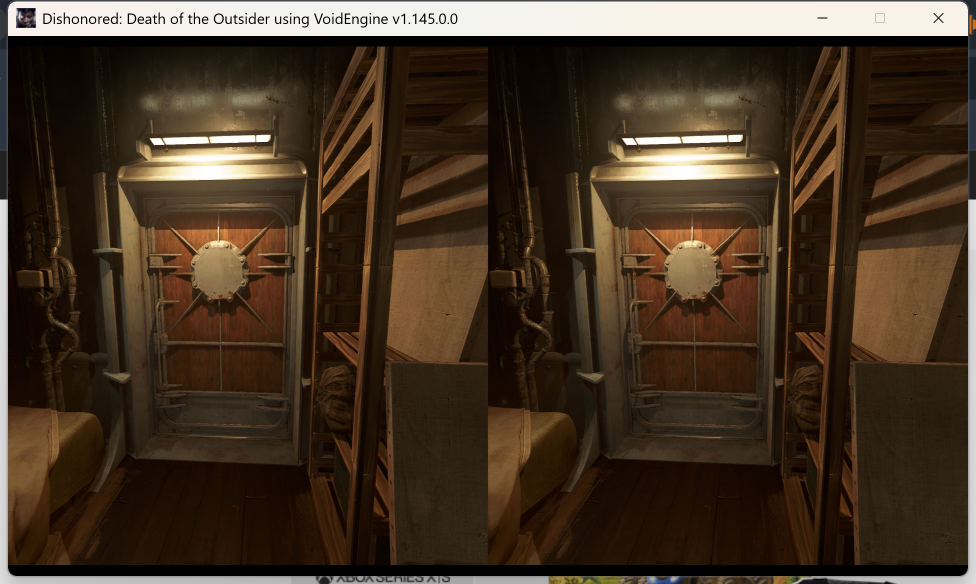

# Death of the Outsider VR

Dishonored: Death of the Outsider (DOTO, Steam app 614570, `Dishonored_DO.exe`) runs on the same Void Engine
family as Dishonored 2. This mod supports it from the **same repository and the same sources**. A generator ports
the Dishonored 2 build to the DOTO executable, and the launcher has an **OUTSIDER** tab that installs and starts it.

Status (2026-11-22, first night): the port pipeline, the DOTO DLL build, the launcher tab and the simulated test runner
exist, and **the VR core runs in Death of the Outsider under the simulated headset**: tracked stereo gameplay with every
frame paired, per-eye head tracking, native turning, comfort settings, per-eye TAA history and the menus on the VR panel
(see §5). Nothing has been tried in a real headset yet. This document is the design and the plan.

## 1. How the port works

The Dishonored 2 mod is pinned to one exact executable. About 1,400 addresses (functions, hook sites, vtables,
globals, import slots, cvars) and several hundred struct field offsets are written into `src/` as hex literals, and
many hooks compare the engine's code bytes before they install. DOTO's executable was built by the same toolchain
(same sections, full MSVC RTTI, no Denuvo) from a newer engine branch (VoidEngine v1.145.0.0 against D2's v1.77.9.0).

Rather than fork the sources, `tools/doto/` translates them:

| Step | Tool | What it does |
|---|---|---|
| Index | `pe_index.py` | Every function from `.pdata` (116k in D2, 120k in DOTO), a relocation-masked hash, call and data references; all RTTI vtables by class name. |
| Match | `match.py` | Pairs functions: unique masked hash, vtable slots by RTTI name, call-graph and data-reference propagation, shape, neighbourhood (92k of 116k paired). |
| Align | `align.py` | Instruction alignment of every pair: displacement votes (struct offsets), rip-target votes (globals), immediates. 88.7k of 91.7k pairs are instruction-identical. |
| Translate | `translate.py` | Any D2 address to DOTO with a method (exact, aligned, voted, pattern, cvar by name, import by symbol, rip-reference scan). |
| Inventory | `inventory.py` | Classifies every hex literal in `src/` (code / rdata / data address, field offset, byte check, comment). |
| Port | `port.py` | Writes `build/doto-src/src/`: addresses translated, moved offsets rewritten, byte checks and FNV code pins regenerated when only relocations differ, identity switched (exe name, SHA-256, `D2VR_GAME_DOTO`). Anything it cannot translate becomes a poison RVA beyond the image, so the mod's own checks switch that one feature off instead of touching the wrong code. |
| Review rules | `offsets.json`, `merge_review.py` | Reviewed per-site rules with evidence: line rules for uniformly shifted structs, site offsets, site-scoped addresses, raw text (hex strings, sizes), accepted byte differences. |
| Build | `build-doto.cmd <ver>` | Regenerates and compiles `build/doto/d2vr_render_probe_arm_v<ver>.dll` with the release flags. |
| Review helpers | `fn_diff.py`, `who_shifts.py`, `live.py` | Side-by-side disassembly, "which functions moved this offset", read-only live memory of the running game. |
| Test | `doto_sim.py` | Simulated-VR session in DOTO through the proxy, its own mod home `build/doto-home`, window captures, PC-in-use checks. |

D2 itself is untouched by the port: the D2 build compiles `src/` as before. The only shared-source change so far
is ABI-neutral for D2 (the Iggy hub hook forwards a fourth register argument; see §2).

Numbers at the time of writing: 1,397 address literals translated (967 exact, 261 voted, 115 aligned, 32 reviewed,
22 other), 16 unique addresses poisoned (all in weapon, door and grenade feature code), 380 offsets rewritten.

## 2. Engine differences found so far

| Area | Dishonored 2 | Death of the Outsider | Evidence |
|---|---|---|---|
| `renderView_t` (the camera the mod writes per eye) | 16 bytes at +0x4c | removed: every field after +0x48 is 0x10 lower (FOV +0x8c, position +0x98, basis +0xbc, forced projection +0xf0, flag +0x130) | renderView copy 0x444c0 vs 0x455c0; TAA jitter 0x3742b0 vs 0x37b1a0 |
| Prepared view stride | 0x3ab0 | 0x3aa0 | same shrink |
| `idGameLocal` fields | player +0x3130b0, logic manager +0x1f6ec8, state +0x341058 | +0x327770, +0x1f75f8, +0x355718 | aligned code, confirmed live |
| `arkPlayer` | components +0x268, model +0xf0, origin +0x300, axis +0x30c | +0x270, +0xf8, +0x310, +0x31c | aligned code, live reads |
| Player camera component | mode/pitch/yaw/aim at +0x25200.. | +0x30 (+0x25230..) | aligned code |
| Arm model | +0x1fe8.., flags +0x1c30 | -0x10, flags +0x1c2d | aligned code, live wrappers |
| Skeleton vtable | slot +0x88 | slot +0x90 (one more virtual) | RTTI slot pairing |
| Iggy external-call hub | 3 arguments | reads a 4th (`r9d`) | hub 0x34800 vs 0x35630; the hook now forwards it |
| Player step (turning) | prologue | same arguments, different register allocation and frame | entry detour accepted after review |
| UI movies | D2 `ui/*.iggy` | different movies | D2 menu/glyph patches are refused by size+hash (fails safe: no VR Settings entry inside the game menu yet) |
| Config | `Dishonored2\base\dishonored2Config.cfg` | `Dishonored_DO\base\dishonored_DOConfig.cfg` | on disk |
| Window title | contains "Dishonored" | "Dishonored: Death of the Outsider using VoidEngine v1.145.0.0" | live |

## 3. Billie Lurk's toolkit in VR

Sources: Bethesda's powers/gadgets announcement, Wikipedia, PCGamesN; the fandom wiki and PCGamingWiki refused automated
fetches, so numbers marked *unverified* must be checked in game. DOTO has **no Heart, no runes and no mana elixirs**:
energy regenerates. Powers are Void artefacts available from the first mission.

### Powers

| Power | In the game | VR design | Hand | Builds on |
|---|---|---|---|---|
| **Displace** | Place a marker only Billie sees, later swap places with it (line of sight needed). Can be placed from Foresight. The Third Eye charm adds a second marker (*unverified*). | Point the casting hand and hold the trigger: a hand-aimed arc and a translucent Billie silhouette at the target. Release places the marker; it stays world-locked. **Swap is a different gesture** (a quick pull of the casting hand toward the chest, or the power button) so placing never teleports by accident. The swap uses the Blink comfort treatment: an 80-120 ms fade or blink, no smooth path, no horizon roll. Two markers get two colours; the swap goes to the one the hand points at. | power hand | `native_blink_aim.hpp` (hand-aimed Blink), comfort vignette |
| **Foresight** | Time stops; Billie leaves her body as a spirit to scout, tags people and objects, sees through walls, can place a Displace marker. Drains energy while active (~18 s, *unverified*). | Highest comfort risk. Default: free spirit camera driven by the left stick at a fixed low speed with the user's own snap/smooth turning and the comfort vignette during motion (time is frozen, so the world is still). Option: "dollhouse" mode, the view stays in the body and a small spirit figure in the casting hand is steered by pointing. A visible tether line back to the body. Tagging = point and trigger; Displace from the spirit uses the same place gesture. | power hand | camera ownership (authored-camera path), `comfort_vignette.hpp`, `native_interaction_aim.hpp` |
| **Semblance** | Steal a face to pass as someone else; drains energy while moving; a face is used once. | Bring the casting hand to the target's face and squeeze, then pull away as if lifting a mask (hand-to-head contact, as the choke and face-grab already do). While active, the stolen face shows on the left wrist next to the watch. | power hand | `native_choke_distance_scope.hpp`, face grab, wrist HUD |
| **Void Strike** | A charged sword blow that knocks enemies back, can assassinate, breaks weak barriers. | Grip + trigger with the sword still, the blade glows and the hand pulses (the existing power-strike charge), release with a fast thrust or swing above a speed threshold. | sword hand | `sword_charge.hpp`, `native_melee.hpp` |
| Original Game+ powers | Blink, Dark Vision, Domino etc. after the campaign (*unverified* list) | The D2 power hand path as is. | power hand | D2 powers |

Void Gaze is Daud's power from the first game, not Billie's; DOTO's equivalents are Foresight's highlights and the
Rat Whispers talisman.

### Weapons and gadgets

| Item | In the game | VR design | Builds on |
|---|---|---|---|
| Sword | Billie's short sword | Unchanged motion combat: swing, block, parry, throw and recall, holster over either shoulder. | D2 sword |
| **Voltaic Gun** | Wrist-mounted launcher, lethal and non-lethal ammo, upgradable | Mounted on the forearm instead of held: aim with the arm, fire with the trigger of that hand, the hand stays free to grab. Ammo type by a wrist twist or the wheel. Left/right arm configurable. | D2 pistol/crossbow fire path, wrist anchoring |
| **Hook Mine** | Sticks to walls, floors, ceilings; pulls enemies in; non-lethal takedown, lethal in numbers | Take it from a hip slot, press it onto a surface by hand (contact places it) or throw it. | grab, throw, `native_gadget_drop.hpp` |
| **Hyperbaric Grenade** | Non-lethal air blast that launches enemies | Take from a holster, throw; optional arc preview, off by default. | `native_grenade_throw.hpp` |
| **Rat Whispers** talisman | Hear rats' clues | Hold the hand to the ear (as the Heart is held up in D2); spatialised audio toward the rats. | Heart listen gesture |
| Bonecharms, Black Market, Contracts | Equip charms; buy gear; optional jobs | The game's own menus on the VR panels; contract text in the left palm like notes. | world UI, note tablet |

### What the engine does (static RE, `tools/doto/reviews/powers-re.md`)

| Item | Engine path in DOTO | Consequence for VR |
|---|---|---|
| Displace | `arkCpntPowerSwapper`; its sensor (`arkCpntPlayerSensorSwapper`, id 0x26) solves the marker from the **player camera's aim block** (`cam+0x252ac` origin, `+0x252b8` axis), target at `sensor+0x148`; place and swap are one Cast virtual (`0x3b7040`); swap requests player state 93 | The mod's gameplay aim already writes that block from the hand, so hand-aimed Displace needs only the publish gate to include the Swapper's aim state (`power+0xa4`). Fallback hook: `0x3e21b0`. |
| Voltaic Gun | `arkCpntWeaponGaussGun`, fire event 206 -> `0x3c1d70` -> launch `0x68e970` (call at `0x3c219d`); target from aim sensor 9, which copies the same camera aim block | Hand aim applies through the existing shot-aim hook; its call table now names `0x3c219d`. Publish the forearm frame (the gun is on the wrist). |
| Foresight | `arkCpntPowerTheEye`: no separate camera; the player entity itself leaves the body under the normal player camera; time is frozen per entity, not globally | Head tracking applies unchanged; add the vignette for spirit motion and a tether line. Live check pending: camera mode during the spirit state. |
| Semblance | `arkCpntPowerMimic`: no ray; the target is the NPC held in the choke path; while mimicking the camera is in mode 2 (authored) | The hand-to-face gesture reuses the choke selection; whether hand aim stays suppressed in mode 2 needs a live check. |

### Situations that need care

- First mission ("One Last Fight"): scripted opening, powers arrive after it.
- The Bank Job: vault keys, scripted vault interactions (grab handling).
- A Hole in the World: Void scenes and unusual geometry; scripted camera.
- Lifts, trams and other rides: comfort vignette.
- Cutscenes: in-engine; the D2 cutscene modes (3D or theatre) apply.
- Billie's right arm has a Void variant model in the resources; if the game swaps it, the tracked arm is re-acquired.

## 4. Plan

| Phase | Goal | State |
|---|---|---|
| 0 | Research, address-mapping lab, generator, DOTO DLL builds | done (this night) |
| 1 | **VR core boots in DOTO**: stereo, head tracking, controllers, turning, menus on the panels, loading/pause detection | **done in simulation** (play7: 6,887 of 6,887 gameplay frames paired, 13,774 head writes, 2,938 verified turns, logic mask and loading detected); headset pending |
| 2 | Hands and body: Billie's arm and body models (body-material route and torso fit only know Corvo/Emily), grab, carry, doors | reviewed rules merged for rig/arm offsets; Billie's mesh tokens needed |
| 3 | Combat: sword, block/parry, takedowns, choke | weapons review in progress |
| 4 | Billie's toolkit: Voltaic Gun on the wrist, Displace aim + swap, Foresight camera, Semblance gesture, Hook Mine, grenade | design above; implementation after phase 1-3 are verified |
| 5 | UI polish: in-game VR Settings entry (DOTO's Iggy movies need their own patches), controller glyphs | D2 patches refused safely |
| 6 | Release: launcher payload embeds the DOTO DLL (`artifacts\doto\repair-vNNNN-test-candidate.json` + `build\doto\<dll>`), headset test | launcher side done |

Verification rule (AGENTS.md): automated and simulated checks do not establish headset visual quality, comfort or
complete gameplay; each phase ends with a headset session.

## 5. What was verified, and how

Simulated sessions (`tools/doto/doto_sim.py`, the mod's simulated OpenXR runtime, Steam build 17712087, a new campaign):

| Run | DLL | Result |
|---|---|---|
| boot1-boot2 | v145703-v145705 | refused at start: a byte pin split across two lines (comfort), output-size getter pins merged with a neighbour array |
| boot3 | v145707 | first complete session: XR focused, menu panel, title and main menu detected (logic mask 64) |
| play2 | v145708 | menus driven by the simulated controller into a new campaign; in gameplay: **two prepared views**, renderView decoded at the DOTO offsets, arkPlayer chain confirmed live, per-eye TAA history installed, comfort applied and restored; no eye pairs (stride) |
| play4-play5 | v145709-v145710 | stride fixed; the whole player-camera chain verified live (`tools/doto/check_camera.py`); still no eye pairs: Setup and Begin share one Present frame in DOTO |
| play7 | v145712 | **tracked stereo gameplay: 6,887/6,887 frames paired, 0 flat frames, 13,774 head-pose writes, 2,938 verified turns** (pipeline depth 0) |
| play9 | v145713 | the launcher's full feature set (tracked arms, controller aim, grab, left aim, native menu pointer, eye AA): see the run report |

Live read-only checks of the running game (`tools/doto/live.py`): prepared views (count 2, eye 1 at +0x3ab0), renderView
fields at -0x10, `arkPlayer` model +0xf8 / components +0x270 (98) / origin +0x310 / axis +0x31c, the logic mask.

## 6. Developer workflow

    python tools/doto/pe_index.py <D2 exe> artifacts/doto-lab/d2.idx          # once per game build
    python tools/doto/pe_index.py <DOTO exe> artifacts/doto-lab/doto.idx
    python tools/doto/match.py artifacts/doto-lab/d2.idx artifacts/doto-lab/doto.idx artifacts/doto-lab/map.pickle
    python tools/doto/align.py artifacts/doto-lab/d2.idx artifacts/doto-lab/doto.idx artifacts/doto-lab/map.pickle artifacts/doto-lab/align.pickle
    tools\doto\build-doto.cmd 145702                                          # regenerate + compile
    python tools/doto/doto_sim.py --name boot --dll build/doto/d2vr_render_probe_arm_v145702.dll

After changing `src/`, rebuild with `build-doto.cmd`: the generator re-reads the sources, so D2 work flows into DOTO.
Read `artifacts/doto-lab/port-report.json` for what was translated, what was poisoned and which byte checks differ.
To add a reviewed fix, put it in `tools/doto/offsets.json` with its evidence (`why`), never in the generated tree.
